<p align="center">
  
</p>

<h1 align="center">bismuth</h1>

<p align="center">
  My ideal ADE: everything I like about <b>t3code</b>, <b>Zeron</b>, <b>VS Code</b>, <b>Cursor</b> and <b>Capy</b>, in one app.
</p>

<p align="center">
  <a href="LICENSE"></a>
</p>

<p align="center">
  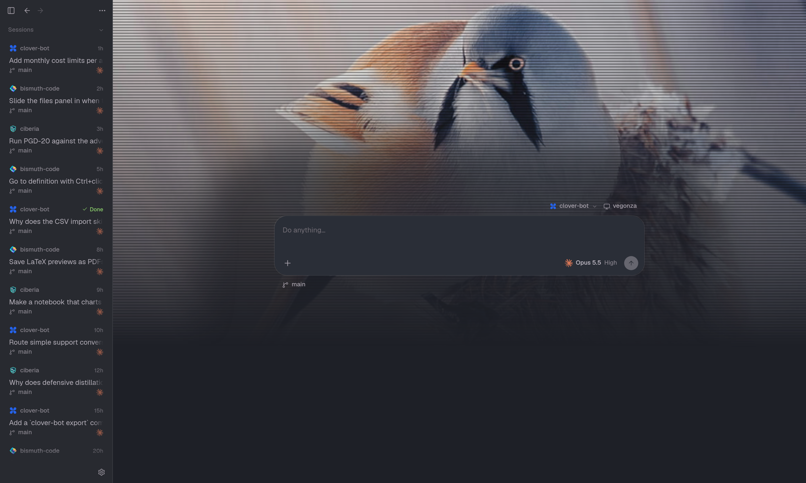
</p>

I kept jumping between tools: one had the nicest conversation view, another the git workflow, another the
editor. So I built the one I wanted. bismuth runs the real agents (Claude Code, Codex and Cursor) on your machine,
all in one window, and wraps them in the bits I missed everywhere else.

The idea is that you never need to open VS Code again: reading code, jumping around it, checking what changed,
moving files, committing, reading the PDF the agent just wrote. All of it happens right next to the conversation.

Here's what you won't find elsewhere, or not all together.

### Agents can show you UI, built with your own components

Agents get a `render` tool. Instead of describing a component, they show it, right in the conversation, built with
your project's own frontend (there's a Vite + React + Tailwind starting point, shadcn/ui included). It runs
sandboxed with no network, and follows your light or dark theme.

### "What did that turn just change?"

bismuth snapshots your folder before every turn. Flip the files panel to **Last turn** and the tree and the
editor's gutters show only what the agent did in that turn, not everything you have uncommitted.

### An editor you don't have to leave

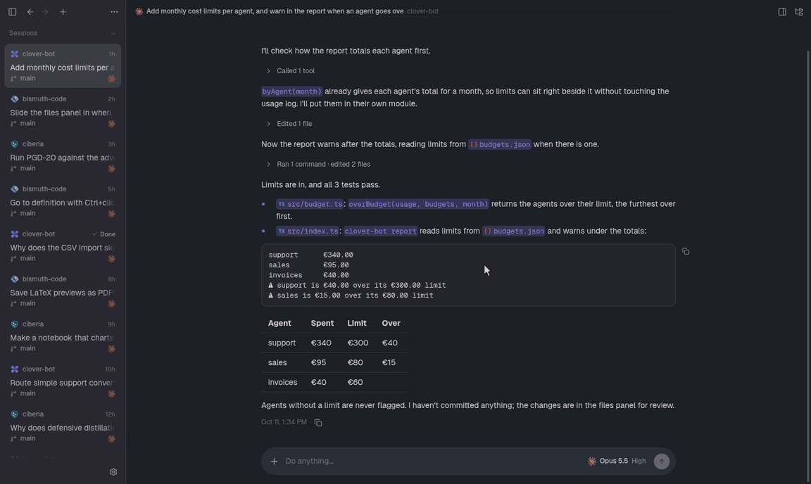

Put the files panel away and it's still one flick away: touch the window's right edge and it slides in over
everything, then slides off again when you leave.

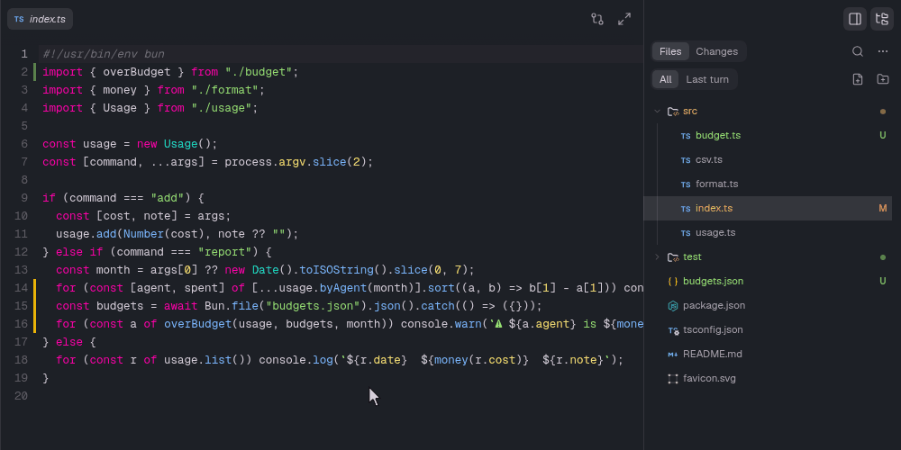

**Go to definition** with <kbd>Ctrl</kbd>+click or <kbd>F12</kbd>, across files. TypeScript works out of the box;
Python, Rust, Go and C/C++ use whichever language server you have installed.

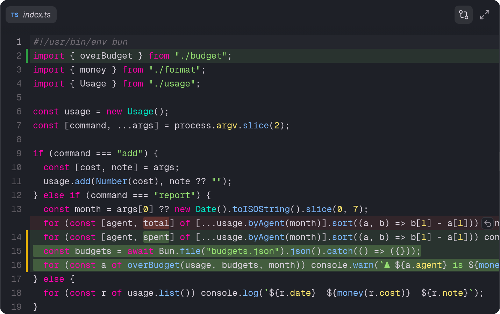

Every file you open has **change bars** in its gutter, like VS Code's. Click one and the changes show right there
in the editor, the old lines in red over the new ones, words highlighted, each with its own revert. No diff
viewer needed.

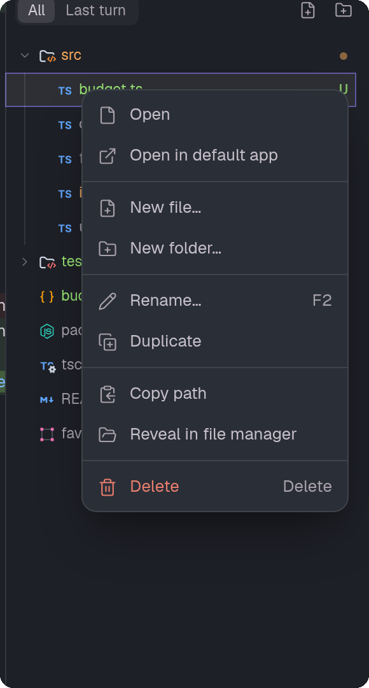

And the tree is a real file manager: new files and folders, rename in place (<kbd>F2</kbd>), duplicate, delete,
drag to move, copy the path, reveal it in your file manager, or open it in its default app.

<br clear="right">

### Opens more than code

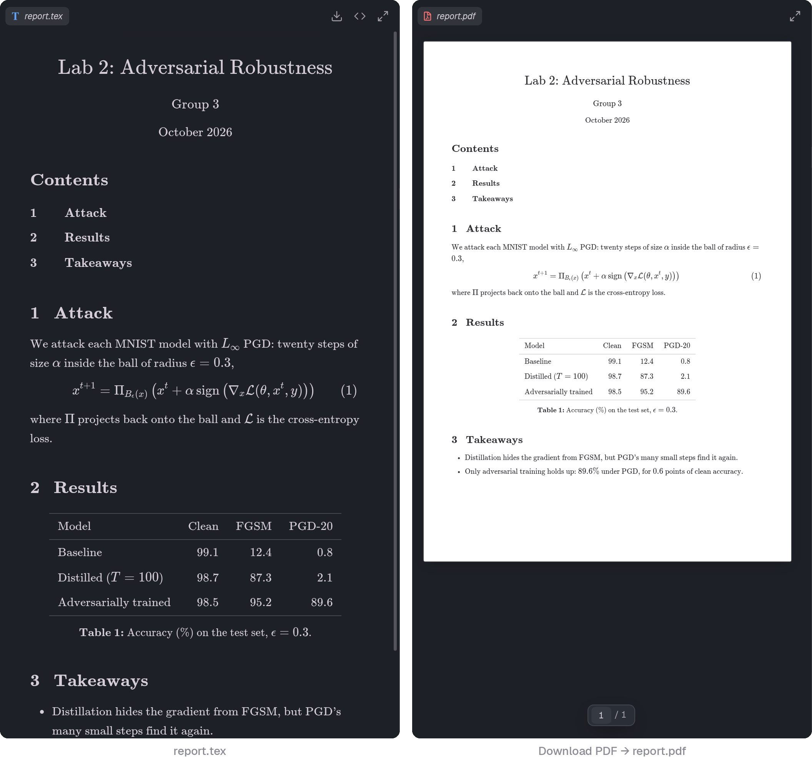

LaTeX is previewed as you'd print it, without compiling anything: title block, contents, numbered equations,
tables. One click on **Download PDF** and you have a proper A4 document.

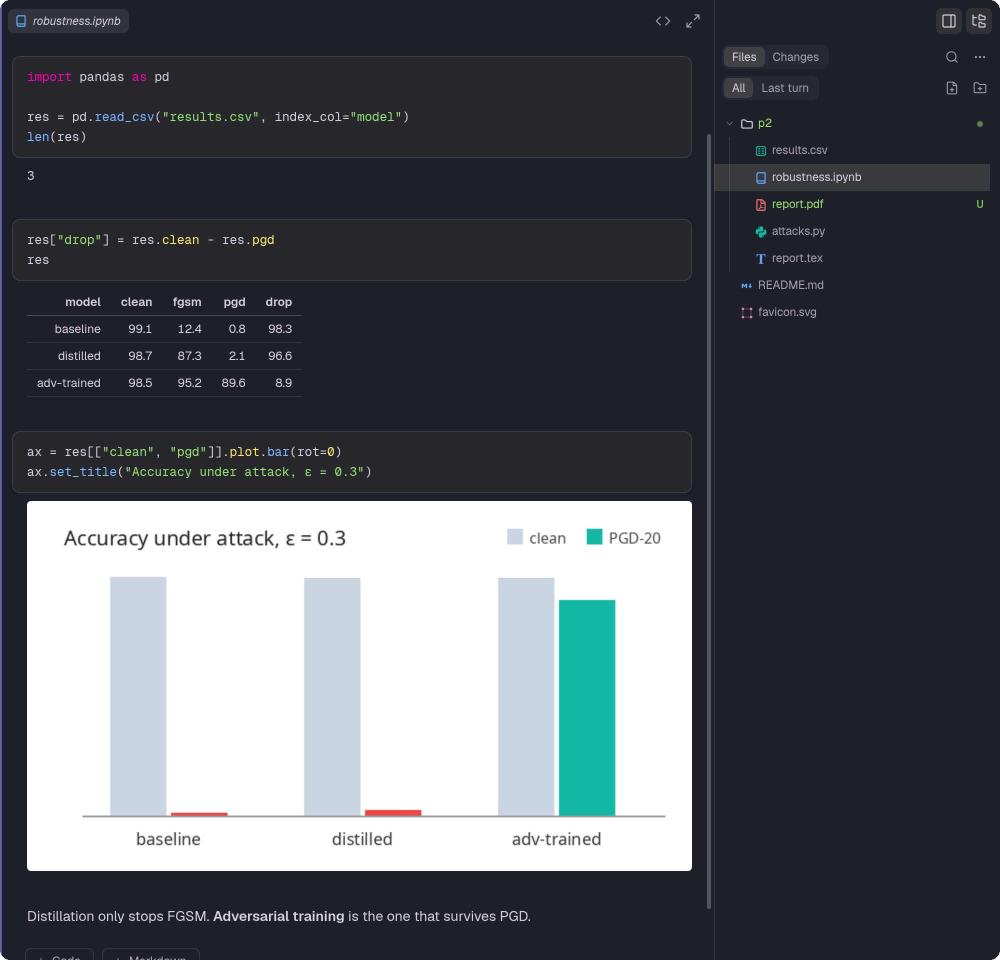

Jupyter notebooks render with their outputs (tables, charts, maths) and you can edit them. Also: Markdown,
Mermaid, PDFs with pinch zoom, CSV with per-column filters (`>10`, `1..5`, `/regex/`), and spreadsheets.

### Git that feels like VS Code's, and a bit more

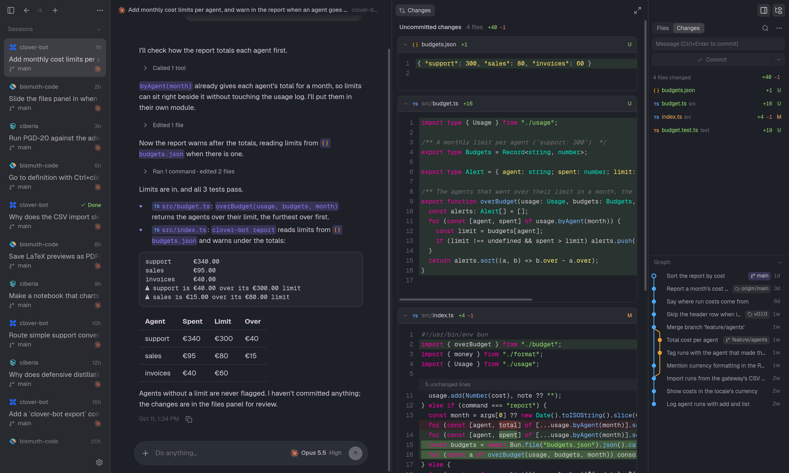

- Commit box, changed files and a **commit graph** with lanes, branches and tags. Click any commit to review it.
- <kbd>Ctrl</kbd>+<kbd>D</kbd> opens every uncommitted diff in one scrolling review tab.
- Click a changed file to review its diff. Middle-click (or three-finger tap) to open the file itself.
- Swipe sideways on the panel to slide between **Files** and **Changes**, like Zen's spaces.
- Pull goes through the ··· menu, never a stray button, and it backs out on its own if it would leave you mid-rebase.
- Not a repo yet? There's an **Initialize Git** button.

### A conversation you can actually read

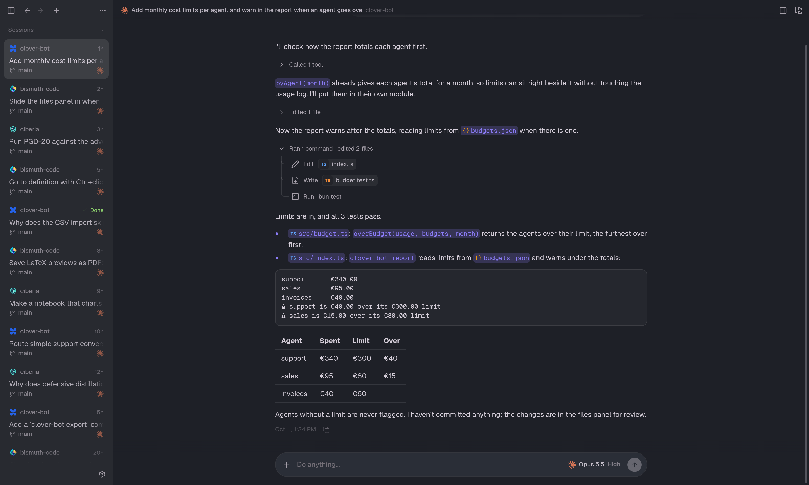

- Tool calls fold into one line per step. Open one for the exact diff or command output.
- File references become links, whichever way the agent writes them: Codex's citations, Claude's `src/a.ts:42`,
  plain Markdown links.
- Type while the agent works: your message waits in a queue you can reorder, or **steer** it into the running turn.
- When an agent asks you questions, you get a little wizard (1–9 to pick, Enter to go on), not a wall of text.

### A sidebar your way

<p align="center">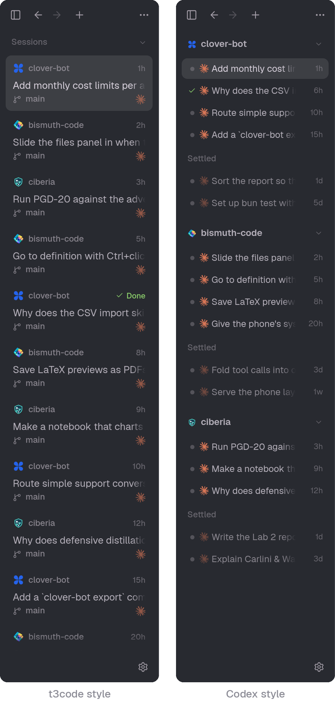</p>

One flat list like t3code, where sessions you're done with drift down to **Settled** on their own. Or grouped by
project like Codex, in compact rows, each project folding away with its own Settled tail. The sidebar's ··· menu switches between them, and has sorting,
compact rows and what each row shows.

### Your phone is a real client

<p align="center">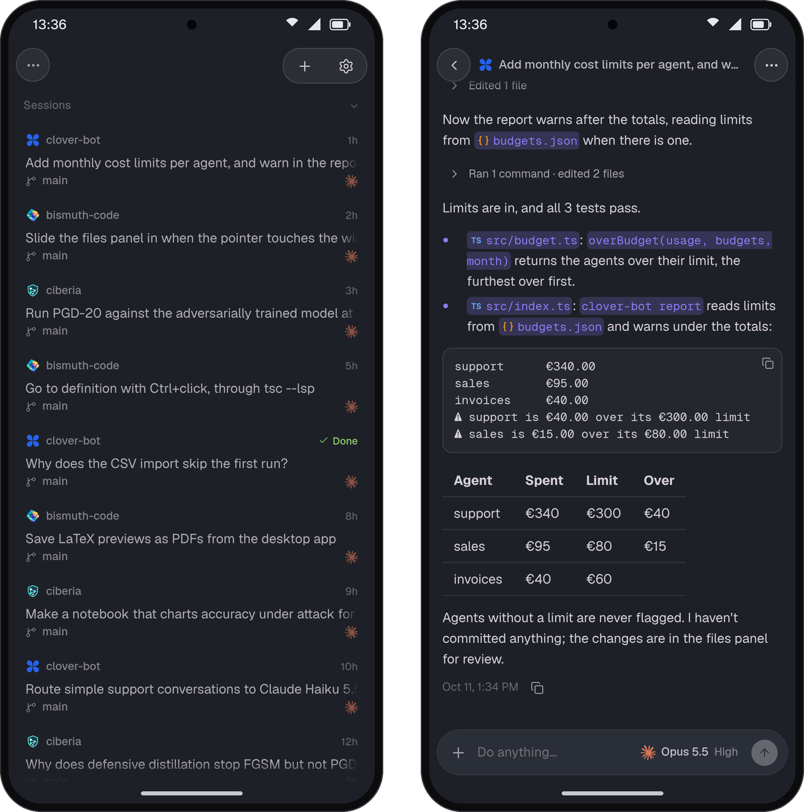</p>

Turn on remote access and bismuth serves itself over Tailscale, only to your own devices. On a phone it's a proper
phone layout, not the desktop squeezed. Add it to your home screen and it feels like an app, with the system bars
in your theme's colour.

### Every provider, account and MCP server in one place

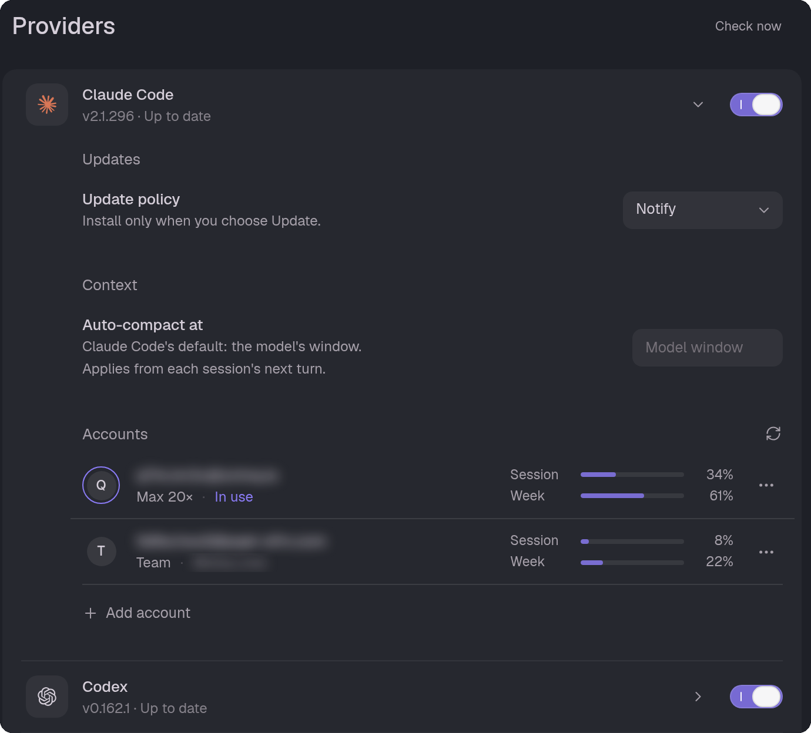

- **Providers**: Claude Code, Codex and Cursor side by side, each with its version, an update policy (notify, or
  update on its own once nothing's running) and a switch to turn it off.
- **Accounts**: save several logins per CLI and switch between them in a click, each with its own usage meters.
- **Context**: choose where Claude Code and Codex sessions auto-compact. The context ring in the composer counts toward
  that point, not just the model's window.
- One Usage page for tokens and cost across all three, and Zeron's model picker with effort and fast mode.

<p align="center">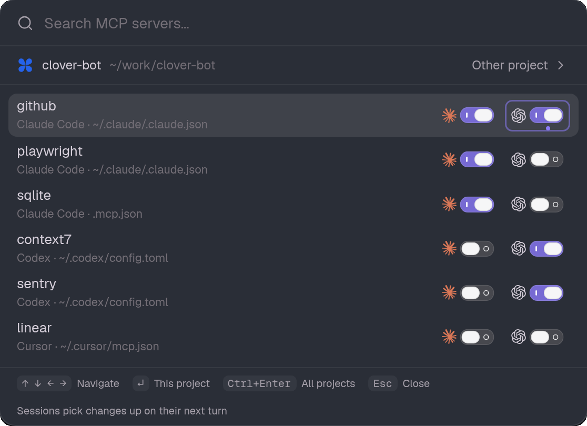</p>

<kbd>Ctrl</kbd>+<kbd>K</kbd> → **MCP servers** lists every server any of the agents defines for a project, wherever
it's defined (`~/.claude.json`, `.mcp.json`, Codex's `config.toml`, Cursor's `mcp.json`), with a switch per agent.
Turn one off for this project or all of them, or hand a server one agent has to the others. The CLIs' own config
files are never touched.

### Make it yours

The new-session screen up top takes a background image of your own, with an effect if you like (dithered, ASCII,
halftone, scanlines).

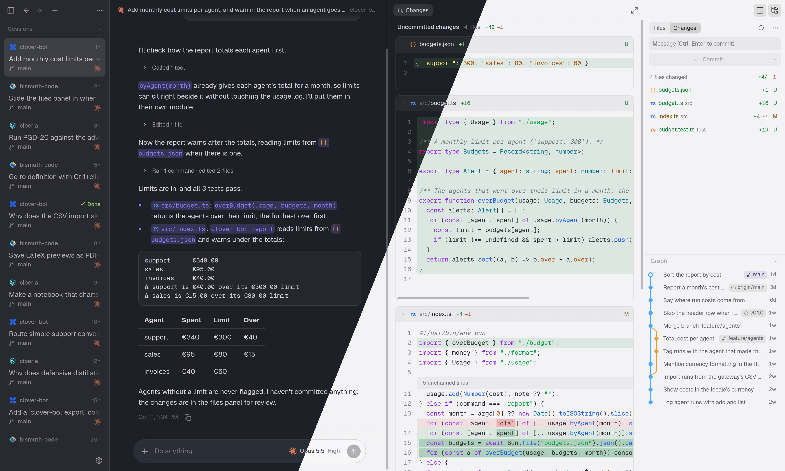

Zeron's theme catalog (Catppuccin, Tokyo Night, Rosé Pine, Dracula, Nord and lots more), accents and frosted glass.
Every shortcut can be rebound, and <kbd>Ctrl</kbd>+<kbd>K</kbd> finds any command or session.

## Try it

You'll need [Bun](https://bun.sh), git, and at least one agent installed and logged in:
[Claude Code](https://docs.claude.com/en/docs/claude-code), [Codex](https://github.com/openai/codex) or
[Cursor](https://cursor.com/cli).

```sh
git clone https://github.com/vegonza/bismuth-code.git
cd bismuth-code
bun install
bun run app
```

`bun start` runs it without Electron (open the printed address in a browser). On Linux, `bun run install:desktop`
adds it to your launcher. I use it daily on Linux; other platforms are untested.

## Credits

bismuth borrows a lot, on purpose. [t3code](https://github.com/pingdotgg/t3code) and
[Zeron](https://github.com/zeronsh/zeron) (both MIT) gave it much of its shape, its themes and parts of its
harnesses. VS Code, Cursor and Capy gave it ideas. File icons are [Symbols](https://github.com/miguelsolorio/vscode-symbols),
UI icons [Lucide](https://lucide.dev), the type [Geist](https://vercel.com/font). The fine print is in
[`THIRD_PARTY_NOTICES.md`](THIRD_PARTY_NOTICES.md).

## License

[MIT](LICENSE)
